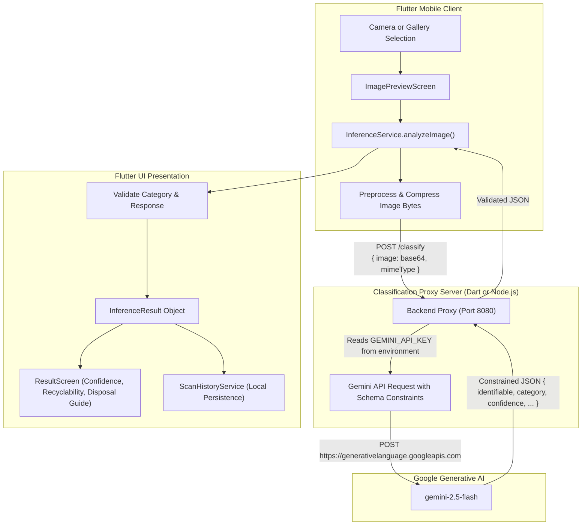

# AI Waste Segregation (Reccly ♻️)

An intelligent Flutter mobile application for real-time waste classification, segregation, recycling education, and eco-tracking.

The app uses Google's Gemini Vision API (`gemini-2.5-flash` / `gemini-1.5-flash`) via a secure backend proxy to accurately classify waste items from device photos into standard waste streams, preventing misclassifications and providing actionable disposal guidelines.

---

## 🎯 Supported Waste Categories

The classification engine analyzes the primary object in the image and categorizes it into exactly one of six streams:

| Category | Recyclable | Typical Items |
| :--- | :--- | :--- |
| **Cardboard** | ✅ Yes | Corrugated boxes, packaging cartons, cardboard egg crates |
| **Glass** | ✅ Yes | Glass drink bottles, jars, glassware |
| **Metal** | ✅ Yes | Aluminium beverage cans, food tins, aerosol cans, foil |
| **Paper** | ✅ Yes | Office paper, newspaper, magazines, paper bags |
| **Plastic** | ✅ Yes | Beverage bottles, detergent jugs, tubs, clean rigid containers |
| **Trash** | ❌ No | General refuse, composite non-recyclables, food-soiled items |

If an image is blurry, dark, or contains no identifiable waste item, the model flags it as unidentifiable rather than fabricating a confident category.

---

## 🏗️ Architecture



---

## 🔐 Security Best Practices

To safeguard the Gemini API key:
- **No hardcoded keys:** The Gemini API key is never hardcoded in Dart source code or committed to Git.
- **Server-side environment variables:** The API key is stored in the backend server's environment variable (`GEMINI_API_KEY`).
- **Git protection:** `.env` and `server/.env` are added to `.gitignore`.

---

## 🚀 Getting Started

### Prerequisites

- Flutter SDK (>= 3.7.0)
- Dart SDK (>= 3.7.0)
- (Optional) Node.js (v18+) if running the Node backend proxy
- A Google Gemini API key from [Google AI Studio](https://aistudio.google.com/)

---

### Step 1: Clone and Install Flutter Dependencies

```bash
flutter pub get
```

---

### Step 2: Configure & Start the Backend Proxy

The backend proxy keeps your API key secure and forwards image classification requests to Gemini with structured JSON output enforcement.

1. Create a `server/.env` file:
   ```bash
   # Windows (PowerShell)
   Copy-Item server/.env.example server/.env

   # Linux / macOS
   cp server/.env.example server/.env
   ```

2. Edit `server/.env` with your API key:
   ```env
   GEMINI_API_KEY=AIzaSy...your_gemini_api_key_here
   GEMINI_MODEL=gemini-2.5-flash
   PORT=8080
   HOST=0.0.0.0
   ```

3. Start the server (choose either Dart or Node.js):

   **Option A: Dart Server (Recommended, no extra installation)**
   ```bash
   dart run server/bin/server.dart
   ```

   **Option B: Node.js Server (Node v18+)**
   ```bash
   node server/server.js
   ```

4. Verify the server is running:
   ```bash
   # Windows PowerShell
   Invoke-RestMethod http://localhost:8080/health

   # Linux / macOS
   curl http://localhost:8080/health
   ```

---

### Step 3: Run the Flutter App

#### Android Emulator
Android emulators automatically route host port `8080` via `10.0.2.2:8080` (configured automatically by `InferenceService`):
```bash
flutter run
```

#### iOS Simulator / Desktop / Web
Routes automatically to `http://localhost:8080`:
```bash
flutter run -d chrome
# or
flutter run -d windows
```

#### Physical Android / iOS Device
When running on a physical phone, connect the phone to the same Wi-Fi network and specify your machine's local IP address:
```bash
flutter run --dart-define=CLASSIFIER_BACKEND_URL=http://<YOUR_LOCAL_IP>:8080
```

#### Developer Standalone Mode (Optional)
If running automated integration checks or development without a local server, a direct API key can optionally be passed at build time:
```bash
flutter run --dart-define=GEMINI_API_KEY=AIzaSy...
```

---

## 🧪 Running Automated Tests

All automated tests use mocked HTTP clients and responses; **no live Gemini API key is required**:

```bash
# Run all unit and widget tests
flutter test

# Run code analysis
flutter analyze
```

### Test Coverage Highlights

- `InferenceResult` model construction and percentage calculation (0%, 94%, 100%).
- All 6 supported waste categories (`Cardboard`, `Glass`, `Metal`, `Paper`, `Plastic`, `Trash`) across various casings.
- Rejection of invalid/unsupported categories with `InferenceException`.
- Complete JSON parsing, field mapping, and fallback defaults.
- Unidentifiable image and low-confidence prediction handling.
- Mocked backend proxy request/response flow.
- Direct Gemini API response format parsing.
- Error handling for HTTP 429 (rate limits), HTTP 500 (server errors), and invalid API keys (HTTP 403).
