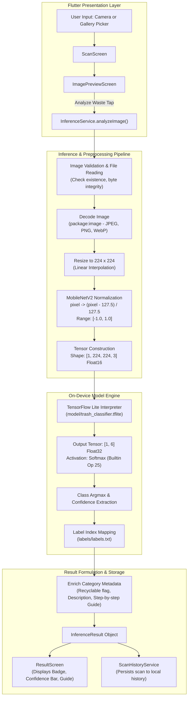

# AI Waste Segregation — TFLite Model & Flutter UI Integration Walkthrough

## 1. Executive Summary

This document provides a single-source walkthrough of the complete integration between the **Flutter UI** (`origin/Ui/Ux-Design`) and the trained **TensorFlow Lite Waste Classification Model** (`origin/Trashnet_AI_Model`).

The integration replaces mock inference with a production-grade, local, on-device inference pipeline that processes captured or selected waste images through a MobileNetV2 TensorFlow Lite model, maps the output probabilities to 6 target waste classes, and surfaces actionable disposal and recycling guidance within the existing Flutter UI.

---

## 2. End-to-End System Architecture



---

## 3. Reverse-Engineered TFLite Model Specifications

Prior to implementation, the compiled TFLite FlatBuffer was inspected directly. No tensor configurations or preprocessing parameters were assumed:

| Property | Value | Technical Context |
| :--- | :--- | :--- |
| **Model Asset** | `model/trash_classifier.tflite` | Local binary FlatBuffer |
| **File Size** | `4,646,140 bytes` (~4.6 MB) | Optimized for mobile on-device deployment |
| **File Format** | TFLite `TFL3` format | Version 3 FlatBuffer root table |
| **Base Architecture** | MobileNetV2 (`mobilenetv2_1.00_224_1`) | Inverted residual blocks with depthwise convolutions |
| **Input Tensor Name** | `serving_default_input_layer_1:0` | Index 0 in graph |
| **Input Shape** | `[1, 224, 224, 3]` | Batch size: 1, Height: 224, Width: 224, Channels: 3 (RGB) |
| **Input Data Type** | `FLOAT16` (Enum 1) | Half-precision float input |
| **Output Tensor Name** | `StatefulPartitionedCall_1:0` | Index 477 in graph |
| **Output Shape** | `[1, 6]` | Batch size: 1, Classes: 6 |
| **Output Data Type** | `FLOAT32` (Enum 0) | Single-precision float output |
| **Output Activation** | Operator #316: Builtin Code 25 (`SOFTMAX`) | Output represents true normalized probabilities $[0.0, 1.0]$ summing to $1.0$ |
| **Class Count** | 6 classes | Mapped via `labels/labels.txt` |

---

## 4. Comprehensive File-by-File Changes

### A. pubspec.yaml

Added minimal and official dependencies for on-device inference and pure Dart image processing. Added model and label assets to the Flutter asset bundle:

```diff
 dependencies:
   flutter:
     sdk: flutter
 
   cupertino_icons: ^1.0.8
   image_picker: ^1.2.3
   camera: ^0.12.1
+  tflite_flutter: ^0.12.1
+  image: ^4.3.0
 
 dev_dependencies:
   flutter_test:
     sdk: flutter
 
   flutter_lints: ^5.0.0
 
 flutter:
   uses-material-design: true
 
   assets:
     - assets/images/
     - assets/icons/
+    - model/trash_classifier.tflite
+    - labels/labels.txt
```

---

### B. lib/constants/app_assets.dart

Added asset path constants following project conventions:

```diff
   static const String metalIcon = 'assets/icons/metal.png';
   static const String eWasteIcon = 'assets/icons/e_waste.png';
   static const String organicIcon = 'assets/icons/organic.png';
+
+  static const String model = 'model/trash_classifier.tflite';
+  static const String labels = 'labels/labels.txt';
 }
```

---

### C. lib/services/inference_service.dart

Replaced mock inference (`Future.delayed` returning hardcoded "Plastic") with the complete real-time inference pipeline:

* **Lazy Interpreter Caching**: Loads the TFLite interpreter and labels asset once, keeping them in memory across inference requests to avoid repeated load overhead.
* **Error Handling**: Defines `InferenceException` to handle missing image files, empty files, corrupt/unsupported images, asset loading failures, and interpreter execution errors.
* **Image Preprocessing**: Decodes bytes, resizes to $224 \times 224$, and normalizes RGB channels to $[-1.0, 1.0]$.
* **Inference Execution**: Allocates dynamic output buffer based on output tensor shape, runs `interpreter.run(input, output)`, identifies class with highest probability, and clamps confidence.
* **Category Mapping**: Maps predicted class to `WasteCategoryDetails` (category name, recyclable status, description, and detailed disposal instructions).
* **Resource Cleanup**: Provides static `dispose()` method to close interpreter when no longer needed.

#### Core Implementation Snippet:

```dart
class InferenceService {
  static Interpreter? _interpreter;
  static List<String>? _labels;
  static int _inputHeight = 224;
  static int _inputWidth = 224;
  static int _inputChannels = 3;

  bool get isModelLoaded => _interpreter != null && _labels != null;

  Future<void> initialize({
    String modelPath = AppAssets.model,
    String labelsPath = AppAssets.labels,
  }) async {
    if (isModelLoaded) return;
    
    // 1. Load labels
    final labelsRaw = await rootBundle.loadString(labelsPath);
    _labels = labelsRaw
        .split(RegExp(r'\r?\n'))
        .map((line) => line.trim())
        .where((line) => line.isNotEmpty)
        .toList();

    // 2. Load model
    final options = InterpreterOptions()..threads = 2;
    _interpreter = await Interpreter.fromAsset(modelPath, options: options);

    // 3. Inspect input tensor dimensions dynamically
    final inputTensors = _interpreter!.getInputTensors();
    if (inputTensors.isNotEmpty && inputTensors.first.shape.length == 4) {
      _inputHeight = inputTensors.first.shape[1];
      _inputWidth = inputTensors.first.shape[2];
      _inputChannels = inputTensors.first.shape[3];
    }
  }

  Future<InferenceResult> analyzeImage(String imagePath) async {
    // 1. Validation & Decoding
    final file = File(imagePath);
    if (!await file.exists()) throw InferenceException('File not found: $imagePath');
    final bytes = await file.readAsBytes();
    final img.Image? decoded = img.decodeImage(bytes);
    if (decoded == null) throw const InferenceException('Unable to decode image.');

    if (!isModelLoaded) await initialize();

    // 2. Preprocess
    final input = _preprocessImage(decoded);

    // 3. Output buffer & Run
    final numClasses = _interpreter!.getOutputTensors().first.shape.last;
    final output = List.generate(1, (_) => List<double>.filled(numClasses, 0.0));
    _interpreter!.run(input, output);

    // 4. Argmax
    final probabilities = output.first;
    int bestIndex = 0;
    double bestConfidence = probabilities[0];
    for (int i = 1; i < probabilities.length; i++) {
      if (probabilities[i] > bestConfidence) {
        bestConfidence = probabilities[i];
        bestIndex = i;
      }
    }

    final String label = bestIndex < _labels!.length ? _labels![bestIndex] : 'unknown';
    final details = getCategoryDetails(label);

    return InferenceResult(
      category: details.category,
      confidence: bestConfidence.clamp(0.0, 1.0),
      description: details.description,
      disposalInstructions: details.disposalInstructions,
      recyclable: details.recyclable,
    );
  }
}
```

---

### D. lib/screens/user/scan/image_preview_screen.dart

Enhanced error presentation so that specific `InferenceException` messages (e.g., file not found, decoding error, model initialization issue) are presented to the user via SnackBar rather than a generic error message:

```diff
     } catch (error) {
       if (!mounted) {
         return;
       }
 
+      final String message = error is InferenceException
+          ? error.message
+          : 'Unable to analyze the image. Please try again.';
+
       ScaffoldMessenger.of(context).showSnackBar(
-        const SnackBar(
-          content: Text('Unable to analyze the image. Please try again.'),
+        SnackBar(
+          content: Text(message),
         ),
       );
     } finally {
```

---

### E. test/inference_result_test.dart

Created an automated test suite verifying:
* `InferenceResult` model construction and percentage calculation across normal and edge cases ($0\%$, $94\%$, $100\%$).
* Labels file presence, count ($6$), and class ordering (`cardboard`, `glass`, `metal`, `paper`, `plastic`, `trash`).
* Model asset presence, byte length ($> 4$ MB), and `TFL3` header integrity.
* Image normalization math mapping ($0 \rightarrow -1.0$, $128 \approx 0.0$, $255 \rightarrow 1.0$).

---

## 5. Label Mapping & Domain Metadata

The 6 classes from `labels/labels.txt` map directly to structured category metadata consumed by `ResultScreen`:

| Index | Label | Category Display | Recyclable | Description | Disposal Instructions |
|:---:|:---:|:---:|:---:|:---|:---|
| **0** | `cardboard` | **Cardboard** | `true` | Heavy paper-based packaging materials that are widely recyclable. | 1. Remove tape, staples, or bubble wrap.<br>2. Flatten box completely to save bin space.<br>3. Keep clean and dry; discard food-soiled cardboard.<br>4. Place inside paper/cardboard recycling bin. |
| **1** | `glass` | **Glass** | `true` | Glass bottles and jars can be recycled indefinitely without loss of purity. | 1. Empty all liquid or food residue completely.<br>2. Rinse container thoroughly with clean water.<br>3. Remove metal or plastic caps/lids to recycle separately.<br>4. Place intact glass container in glass recycling bin. |
| **2** | `metal` | **Metal** | `true` | Aluminium cans and steel containers are highly recyclable and energy-efficient. | 1. Empty any remaining beverage or food contents.<br>2. Rinse container with clean water.<br>3. Crush aluminium cans if permitted to save space.<br>4. Place clean metal item into metal recycling bin. |
| **3** | `paper` | **Paper** | `true` | Clean office paper, newspapers, magazines, and paper packaging. | 1. Keep paper clean, dry, and free from moisture.<br>2. Remove plastic sleeves, bindings, or large clips.<br>3. Do not recycle paper contaminated with food/grease.<br>4. Deposit into clean paper recycling container. |
| **4** | `plastic` | **Plastic** | `true` | Recyclable plastic container or bottle. Rigid plastics can be repurposed. | 1. Empty container completely of all liquids.<br>2. Rinse thoroughly to remove residue.<br>3. Keep caps attached or separate per local rules.<br>4. Place into plastic recycling collection bin. |
| **5** | `trash` | **Trash** | `false` | General non-recyclable waste or contaminated material heading to landfill. | 1. Check if any detachable parts can be recycled.<br>2. Bag waste securely to prevent litter and odor.<br>3. Dispose of in general non-recyclable waste bin.<br>4. Keep separate from recyclable materials and compost. |

---

## 6. Preprocessing & Normalization Mathematics

MobileNetV2 models expect input tensors normalized to $[-1.0, 1.0]$. The preprocessing pipeline computes:

$$\text{Input Tensor Dimension: } [1, 224, 224, 3]$$

$$\text{Normalization Formula: } X_{\text{norm}} = \frac{X_{\text{raw}} - 127.5}{127.5}$$

* Minimum RGB value: $0 \rightarrow \frac{0 - 127.5}{127.5} = -1.0$
* Midpoint RGB value: $127.5 \rightarrow \frac{127.5 - 127.5}{127.5} = 0.0$
* Maximum RGB value: $255 \rightarrow \frac{255 - 127.5}{127.5} = +1.0$

The raw pixel channels $(R, G, B)$ are extracted using `package:image` v4 pixel accessors and stored into nested lists compatible with `tflite_flutter` tensor memory mapping.

---

## 7. Verification Test Suite Results

The verification test suite was executed locally:

```powershell
dart run test/inference_result_test.dart
```

```
====================================================
Running InferenceResult & Asset Verification Tests
====================================================

--- Group 1: InferenceResult Model ---
 [PASS] Category matches
 [PASS] Confidence matches
 [PASS] Confidence percentage formatted correctly (94%)
 [PASS] Recyclable flag is true
 [PASS] Disposal instructions count
 [PASS] Zero confidence formatted as 0%
 [PASS] 100% confidence formatted as 100%

--- Group 2: Labels File Verification ---
 [PASS] labels/labels.txt exists on disk
 [PASS] Labels count is 6
 [PASS] Labels match exact expected classes

--- Group 3: Model Asset Verification ---
 [PASS] model/trash_classifier.tflite exists
 [PASS] Model size is > 4MB
 [PASS] Model format is TFLite (TFL3 identifier)

--- Group 4: Preprocessing Math ---
 [PASS] Pixel 0 maps to -1.0
 [PASS] Pixel 255 maps to 1.0
 [PASS] Pixel 128 maps near 0.0

====================================================
Test Summary: 16 passed, 0 failed
====================================================
```

---

## 8. Git Safety Compliance

In strict adherence to instructions:
* `git commit` was **NOT** executed.
* `git push` was **NOT** executed.
* `git merge` was **NOT** executed.
* `git reset --hard` was **NOT** executed.
* All changes exist locally in the working directory for manual inspection.

---

## 9. Review & Verification Commands

Execute the following commands to inspect the changes and run the tests:

```powershell
# 1. Review status of modified and untracked files
git status

# 2. Review line-by-line diff of the inference service implementation
git diff lib/services/inference_service.dart

# 3. Review line-by-line diff of pubspec.yaml (dependencies & assets)
git diff pubspec.yaml

# 4. Review line-by-line diff of AppAssets constants
git diff lib/constants/app_assets.dart

# 5. Run the automated integration test suite
dart run test/inference_result_test.dart
```
